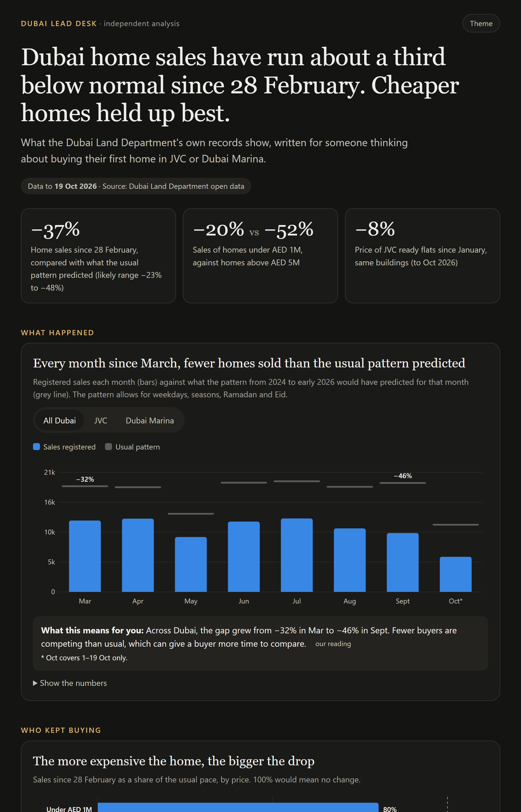

# Dubai Lead Desk

[](https://github.com/mithuncyriac/dubai-lead-desk/actions/workflows/check.yml)

Who kept buying homes in Dubai after 28 February 2026, worked out from the Dubai Land Department's own records, and a free lead desk in n8n built on the answer.

**Dashboard:** [mithuncyriac.github.io/dubai-lead-desk/](https://mithuncyriac.github.io/dubai-lead-desk/) (one page, no login, works on a phone)
**Data to:** 19 Oct 2026



## The problem

Since the war began on 28 February, fewer people have been buying homes in Dubai. A brokerage still gets enquiries every day, though, and it has to decide which ones get a fast reply and which ones need a senior agent. I wanted to know which buyers were still active, so that decision could rest on data rather than on a feeling.

## What the data shows

- Home sales since 28 February ran **37%** below what the usual pattern predicted (87,052 registered against about 137,260 expected). The likely range is −23% to −48%.
- The gap is getting wider: −32% in March, −46% in September.
- The cheaper the home, the smaller the drop. Under AED 1M, sales run at about 80% of the usual pace. Above AED 5M, about 48%.
- Prices moved far less than sales. Ready flats in JVC are 8% cheaper than in January, comparing sales in the same buildings, and in Dubai Marina 5% cheaper.
- Asking prices on the portals sit above what homes sold for: about 7% in JVC and 9% in Dubai Marina.
- JVC has 19,756 off-plan flats still waiting for handover. At the current pace of 767 sales a month, that is about 26 months of sales.

**What I'd do with it** (a recommendation, not a measured result): answer the many smaller enquiries fast and automatically, give the rare large ones to a senior agent from the first message, and check every budget against post-war prices that are refreshed each month.

## The lead desk

Five n8n workflows (n8n 2.42.5, self-hosted, free):

- **A · Lead desk**: reads an enquiry, checks the budget against DLD's recent sale prices, sorts it into Hot, Warm or Cold, drafts a reply for an agent to approve, and logs it. Repeat enquiries from the same phone are merged.
- **F · Enquiry form**: a web form that feeds A.
- **B · Test harness**: sends 90 test enquiries through A and scores the result against answers A never sees.
- **C · Weekly refresh**: every Monday, picks up a new DLD export, reruns every number, runs the tests and commits.
- **E · Errors**: logs any failure.

The version here reads enquiries with rules, so it costs nothing to run. On the 90 test enquiries it gets 77 right (86%). It misses wording it has no rule for, like numbers written as words or "a year and a half". An AI model reading the same messages blind got 90/90, but that needs a paid API key. The test messages were written for the test; they are not real buyers.

Setup and a demo script: [desk/SETUP.md](desk/SETUP.md), [desk/DEMO_SCRIPT.md](desk/DEMO_SCRIPT.md).

## Run it yourself

Python 3.14, about a minute:

```bash
pip install -r requirements.txt
gunzip -k data/dld/*.csv.gz
python run_all.py
python -m pytest tests
```

`run_all.py` goes from the raw DLD files to `site/facts.json`, the single file every number in the dashboard, this README and the posts comes from. The tests fail if a headline number moves, and they check that the JavaScript desk reads every test message exactly as the Python version does. GitHub Actions runs all of this on every push (the badge at the top).

## How it was checked

My totals against figures other people published from the same DLD records: 6 match, 3 close, 3 miss. The misses stay in, with the reason.

| Check | This analysis | Published | Source | Verdict |
|---|---|---|---|---|
| Q3 2026 residential deals | 34,047 | 34,000 | Cavendish Maxwell via The National | **match** |
| Q3 2026 deals, change vs Q3 2025 | −36.5% | −38.0% | Cavendish Maxwell via The National | **match** |
| Q3 2026 sales value, change vs Q3 2025 | −46.4% | −47.0% | Cavendish Maxwell via The National | **match** |
| Q3 2026 sales value, AED bn | AED 67.9 bn | AED 72.6 bn | Cavendish Maxwell via The National | **miss**: level differs: their total likely includes procedures we exclude (e.g. land and building sales classed outside 'Residential') |
| Jan–Sep 2026 deals | 110,672 | 112,580 | Cavendish Maxwell via The National | **match** |
| Jan–Sep 2026 deals, change vs 2025 | −19.9% | −23.0% | Cavendish Maxwell via The National | **close**: small gap; their 2025 base may include late-registered deals our export dates differently |
| Monthly sales Mar–Sep vs Jan–Feb 2026 | −22.2% | −26.0% | S&P Global Ratings (DLD data) | **close**: S&P counts all sales incl. commercial; we count residential only |
| First 12 days of March, change vs 2025 | −6.4% | −37.0% | Goldman Sachs (UAE-wide) | **miss**: miss: Goldman covers the whole UAE with an unpublished method; March 2025 was Ramadan, which lowers our comparison base |
| Price move in March 2026 (ready flats, JVC) | +2.0% | −5.9% | ValuStrat Price Index | **miss**: miss in timing: ValuStrat is valuation-based and reacts at once; March registrations were mostly deals agreed before the war. Our index falls from May |
| Price move Feb–Oct 2026 (ready flats, JVC) | −5.8% | −10.0% | ValuStrat (cumulative since late Feb) | **close**: same direction, smaller: ValuStrat covers all Dubai incl. prime villas |
| JVC average flat price, AED | AED 1,070,795 | AED 1,075,878 | Bayut (DLD 12-month average) | **match** |
| Marina flat sales per year | 2,197 | 2,205 | Bayut (DLD 12-month count) | **match** |

**A forecast you can check.** Dubai home sales in November 2026 should land between **9,800 and 11,600**. The usual pattern would expect about 18,400. The low end assumes the gap of the latest weeks holds (−47%), the high end the average since 28 February (−37%). I'll check it against DLD's November records on 7 December 2026. If it misses, the model is missing something.

## Data

- **Dubai Land Department open data**: 472,404 residential sales from 2024-01-01 to 2026-10-19, 46,023 Ejari rental contracts for flats in JVC and Dubai Marina, DLD projects and valuations. Included in `data/dld/` (gzipped, unchanged).
- **Portal listings**: 214 listings from Bayut and Property Finder, checked on 21 October 2026. Only totals are published (duplicate share, asking-price gap). The listings themselves are not in this repo.
- **Buyer posts from public forums**: used only to see how the desk handles real wording. Neither the posts nor any usernames are included.

## Limitations

- The "usual pattern" is a model of 2024 to early 2026 that allows for weekdays, seasons, Ramadan and Eid. It cannot separate the war from anything else that changed after 28 February, so the gap is "below the usual pattern", not "caused by" one thing.
- The range around the main figure is wide. A simpler trend model gives −35% instead of −37%.
- DLD registers a sale when it is recorded, sometimes weeks after the deal. The latest month covers only part of the month, and recent months may still rise a little.
- Asking prices come from one day's listings.
- The desk's test messages were written for the test.

## Licence

Code: MIT. The DLD files in `data/dld/` are Dubai Land Department open data, republished with attribution under its own terms.

Independent analysis by Mithun Cyriac. Built with Python, statsmodels, n8n and an AI model. Not financial advice.
